# GitTree

Grow a tree from your GitHub activity and put it on your profile.

GitTree is a GitHub Action that reads a user's public activity and draws an animated SVG tree. Languages become limbs, repos become branches, recent commits become leaves, and the scene follows the real seasons. It has no dependencies and needs no server or personal access token.


| Early autumn | Winter |
| --- | --- |
|  |  |

These three images are one sample profile drawn in different seasons. Live example: [@AlexanderGiannak](https://github.com/AlexanderGiannak).

## Quick start

You need a profile repository: a public repo named exactly like your username, whose `README.md` shows on your profile.

1. In that repo, create `.github/workflows/gittree.yml`:

   ```yaml
   name: Grow GitTree

   on:
     schedule:
       - cron: "8,23,38,53 * * * *" # every 15 minutes; use "17 9 * * *" for once a day
     workflow_dispatch:

   permissions:
     contents: write

   concurrency:
     group: gittree
     cancel-in-progress: false

   jobs:
     grow:
       runs-on: ubuntu-latest
       steps:
         - uses: actions/checkout@v5
         - uses: AlexanderGiannak/gittree@v1
   ```

2. Add the image to your `README.md`:

   ```html
   <p align="center">
     
   </p>
   ```

3. Open the **Actions** tab, pick **Grow GitTree** and press **Run workflow**. The first run commits `assets/tree.svg`. After that the workflow only commits when your tree has changed.

## How to read a tree

| What you see | What it means |
| --- | --- |
| Trunk height | All-time contributions on a log scale, full-grown at about 3,200 |
| Trunk girth | Number of days with at least one contribution, at full thickness after about 190 |
| Limbs | Top languages, scored half by how many repos use them and half by code size. The strongest is the central leader |
| Branches on a limb | One twig per repo in that language, oldest nearest the trunk. Length follows the repo's code size |
| Leaves | Denser on repos with more commits in the last 90 days |
| Leaf and bud color | The repo's language color on GitHub, blended with the season |
| Blossoms (spring) and fruit (summer, autumn) | Pull requests merged in the last year |
| Birds | Stars across your repos: one bird each at 1, 10, 50 and 200 |
| Grass | The last 371 days, one blade per day. Taller and greener means more contributions that day |
| Sun | Current streak. With no streak it sits behind a cloud |
| Wind | Activity in the last 14 days |
| Season | Today's date, blended gradually through the year |

A tree never shrinks. After a quiet stretch the canopy thins, the grass dries and the sun hides, but the trunk and branches stay.

## How it grows

| A few weeks in | Year two | Year five |
| --- | --- | --- |
|  |  |  |

The whole tree is recalculated from your full history on every run, and its random details are seeded by your username. So it changes gradually from day to day instead of reshuffling.

## Options

All inputs are optional.

| Input | Default | What it does |
| --- | --- | --- |
| `username` | The repo owner | Whose activity grows the tree |
| `output` | `assets/tree.svg` | Where the SVG is written |
| `exclude` | Markup and config languages such as HTML, CSS and Dockerfile | Comma-separated languages that never get a limb. Setting this replaces the default list; `none` excludes nothing |
| `commit` | `true` | Commit and push the SVG when it changed. Set to `false` to handle the file yourself |
| `commit-message` | `Grow tree [skip ci]` | Message for that commit |
| `token` | The workflow's built-in token | Token used to read public activity |

Example with options:

```yaml
- uses: AlexanderGiannak/gittree@v1
  with:
    output: images/my-tree.svg
    exclude: "HTML,CSS,Jupyter Notebook"
```

## How it works

1. **Fetch.** One script, `tree.mjs`, asks GitHub's GraphQL API for the user's public repos and their languages, merged pull requests, the contribution calendar year by year, and commits per repo over the last 90 days. That is one request per year of account age, plus two.
2. **Derive.** It turns that into numbers: totals, active days, streak, the last 371 days, and the languages ranked with their repos.
3. **Season.** Today's date becomes a position in the year. Leaf cover, autumn color, blossoms, snow and the sky palette blend smoothly between seasons.
4. **Build.** It lays out the trunk, limbs, boughs and twigs. A language with more than 12 repos splits into sibling limbs, and every tree gets at least three limbs.
5. **Render.** It writes one SVG with CSS animations for swaying limbs, falling leaves, drifting clouds and waving grass. There is no JavaScript in the image, so it animates inside a GitHub README.

Two runs on the same day with the same activity produce the same file, which is why frequent schedules don't create noise commits.

## Run it locally

Requires Node 18 or newer.

```bash
GITHUB_TOKEN=<any token> node tree.mjs --user <login> --out tree.svg
```

Useful flags:

- `--save-data data.json` keeps the fetched data, and `--data data.json` renders from it without calling GitHub.
- `--season-date 2027-01-15` previews another season.
- `--date 2026-05-01` draws the tree as it was on that day.
- `--exclude "HTML,CSS"` sets the languages that never get a limb.

## Limits

- **Public activity only.** Private repos and private contributions are not read.
- **First 100 repos and 100 merged pull requests.** Forks are skipped.
- **Northern hemisphere seasons.**
- **Up to six languages get limbs.** Repos in other languages grow on the leader limb and keep their own leaf color.
- **Schedules are approximate.** GitHub can delay scheduled workflows, and it disables them in public repos after 60 days without repository activity. If your tree stops updating, re-enable the workflow in the Actions tab.
- **Bot commits don't count as contributions,** so the tree can't grow itself.

## License

[MIT](LICENSE)
